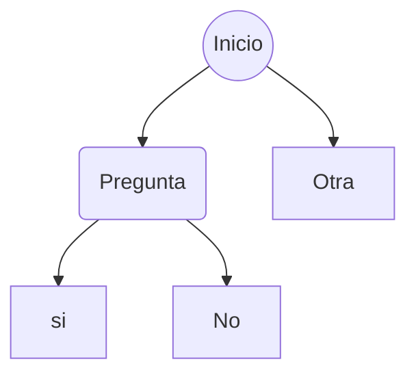
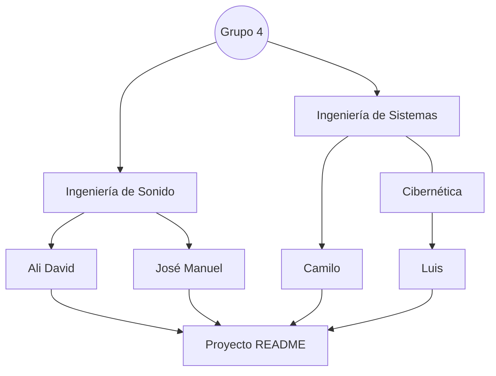

# Hola este es el título

## Este es el subtitulo

### Este es el tercer título

| column 1 | columna 2 | columna 3 |
| --- | --- | --- |
| texto 1 | texto 2 | texto 3 |
| texto 4 | texto 5 | texto 6 |

## Integrantes del equipo - Grupo 4

| Nombre | Apellido | Carrera | Imagen |
| --- | --- | --- | --- |
| Ali David | Moron | Ingeniería de Sonido |  |
| José Manuel | Gómez | Ingeniería de Sonido |  |
| Camilo | Martínez | Ingeniería de Sistemas y Cibernética |  |
| Luis | Mateo | Ingeniería de Sistemas y Cibernética |  |

## Diagrama

