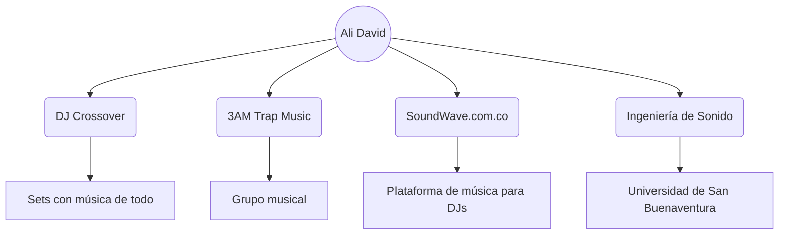

# 🎧 Ali David Moron | DJ Crossover

## 🎓 Estudiante de Ingeniería de Sonido

Universidad de San Buenaventura, sede San Benito.

### 🔥 Sobre mí

Soy DJ crossover: en mis sets mezclo de todo para que nadie se quede quieto. Pertenezco a 3AM Trap Music y soy owner de SoundWave.com.co, una plataforma de música para DJs. La música es mi vida y la estoy convirtiendo en mi carrera.

### 🗺️ Mi mundo

### 🎚️ Mis proyectos

| Proyecto | Qué es | Mi rol |
| --- | --- | --- |
| DJ Crossover | Sets que mezclan todos los géneros | DJ |
| 3AM Trap Music | Grupo musical | Integrante |
| SoundWave.com.co | Plataforma de música para DJs | Owner |
| Ingeniería de Sonido | Mi carrera universitaria | Estudiante |

### 📫 Dónde encontrarme

🌐 SoundWave.com.co

Hecho por DeiVid 🎶
